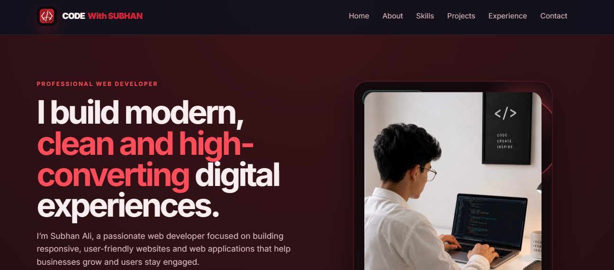
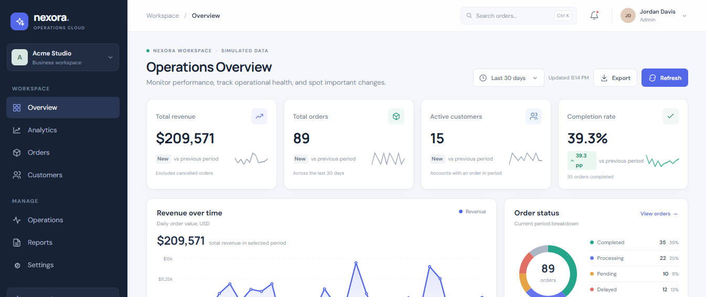
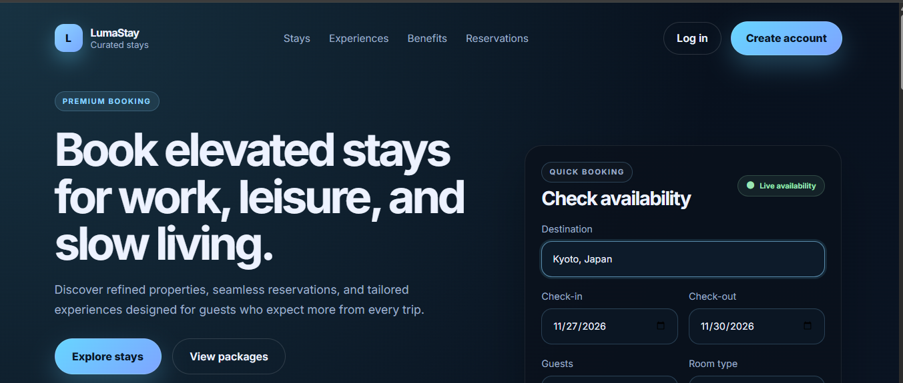

# Sauban Ali — Developer Portfolio

<div align="center">

[](https://sauban_professional_developer.com/)
[](https://linkedin.com/in/sauban-ali-0172ab43a)
[](https://github.com/Sauban1222)

**Professional Web Developer | Frontend Developer | Full Stack MERN Developer**

</div>

---

## About

This is my personal developer portfolio, designed to showcase my skills, projects,
education, and professional journey. I build responsive, accessible, and
user-focused digital experiences using modern frontend and full stack technologies.

The website presents an animated introduction, project showcase, skills section,
education and development timeline, contact details, and a working message form.

## Live Website

- **Portfolio:** [sauban_professional_developer.com](https://sauban-professional-developer.netlify.com/)

## Preview

<div align="center">
  
</div>

## Projects

| Project | Category | Description | Live Demo |
|---|---|---|---|
| NOVARA | E-commerce | Premium storefront with product discovery and a modern shopping experience | [View Project](https://novara-ecommerce.netlify.app/) |
| NEXORA | Dashboard | Operations dashboard for monitoring performance and business metrics | [View Project](https://n-exora-dashboard.netlify.app/) |
| Developer Portfolio | Portfolio | Personal portfolio for presenting skills, projects, education, and contact details | [View Project](https://devsauban.netlify.app/) |
| LumaStay | Premium Booking | Elegant accommodation booking experience for exploring stays and reservations | [View Project](https://lumastay-premium-booking-experience.netlify.app/) |
| Coffee Website | Cafe | Polished cafe website with branding, menu, and customer engagement sections | [View Project](https://velvet-roasts.netlify.app/) |
| Aurex Rewards | Rewards | Modern loyalty and rewards platform with an engaging interface | [View Project](https://aurex-reward-s.netlify.app/) |
| Expense Tracker | Finance | Web application for tracking expenses and personal spending | [View Project](https://syntecxhub-expensetracker.netlify.app/) |

## Featured Project Previews

<table>
  <tr>
    <td align="center" width="50%">
      <strong>NOVARA</strong><br>
      
    </td>
    <td align="center" width="50%">
      <strong>NEXORA</strong><br>
      
    </td>
  </tr>
  <tr>
    <td align="center" width="50%">
      <strong>Developer Portfolio</strong><br>
      
    </td>
    <td align="center" width="50%">
      <strong>LumaStay</strong><br>
      
    </td>
  </tr>
</table>

## Technologies

### Frontend

- HTML5
- CSS3
- JavaScript
- React.js
- Responsive Web Design
- Modern UI and UX

### MERN Stack

- MongoDB
- Express.js
- React.js
- Node.js
- REST APIs

### Tools

- Git and GitHub
- VS Code
- Postman
- Figma
- Netlify

## Website Features

- Responsive layout for mobile, tablet, and desktop
- Animated hero role rotation
- Scroll reveal animations
- Project showcase with live demo links
- Education and professional development timeline
- Skills and technology overview
- Mobile navigation menu
- Contact form integration
- Direct email, phone, and WhatsApp links

## Project Structure

```text
Portfolio/
├── index.html
├── style.css
├── script.js
├── README.md
└── images/
    ├── Profile.jpeg
    ├── project1.png
    ├── project2.png
    ├── project3.png
    ├── Project4.png
    ├── Project5.png
    ├── Project6.png
    └── Project7.png
```

## Contact

- **Email:** [developersauban12@outlook.com](mailto:developersauban12@outlook.com)
- **Phone / WhatsApp:** [+92 313 5568768](https://wa.me/923135568768)
- **LinkedIn:** [Sauban Ali](https://linkedin.com/in/sauban-ali-0172ab43a)
- **GitHub:** [Sauban1222](https://github.com/Sauban1222)
- **Portfolio:** [Sauban Ali](https://sauban-professional-developer.netlify.com/)

## License

This project is available for portfolio and educational use.
